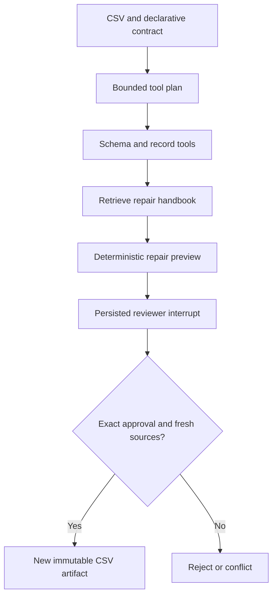

# Data Contract Agent
[](https://github.com/AmmarFarid10/data-contract-agent/actions/workflows/ci.yml)

**Investigate broken CSV feeds and create a reviewed repair artifact without overwriting the source.** Operations teams regularly receive duplicated, malformed or schema-drifting imports. This agent profiles a bounded CSV, checks a declarative contract, retrieves repair policy, previews supported corrections and pauses for an independent reviewer.

## Concrete demonstration
The synthetic order feed contains an exact duplicate, whitespace, a spreadsheet formula, an invalid numeric amount and an unknown status. The proposed artifact removes the exact duplicate, trims cells and escapes the formula. It explicitly retains the unresolved amount/status issues for manual correction. It never guesses replacement values or claims the file is fully repaired.

## What is implemented
- Validated CSV ingestion with row/column/byte limits and immutable source revisions.
- Contracts for required fields, types, bounds, allowed values, uniqueness and extra columns.
- Actual registered read tools for schema inspection, record profiling and policy retrieval inside a bounded LangGraph workflow.
- A schema-constrained optional Ollama planner and policy-grounded repair advisor. Only aggregate findings and handbook excerpts go to the model; raw CSV rows are excluded.
- Retrieval-backed authorization of a small repair allowlist: whitespace trim, exact-duplicate removal and spreadsheet formula escaping.
- A deterministic preview with changed-cell/dropped-row counts, output hash and unresolved violations.
- SQLite checkpoints, idempotent run creation, 15-minute proposal expiry, exact-hash approval and a different same-tenant reviewer.
- Approved artifact creation and decision recording in one SQLite transaction. Stale CSV or handbook snapshots reject the effect. Sources are never overwritten; artifacts require authenticated downloads.

## Run it
Python 3.12 and uv are required. Start with the self-contained API demo; it creates temporary data and fresh test identities and makes no external model/service calls:

```bash
uv sync --frozen --extra dev
uv run python scripts/demo.py --check
```
Then run the same demo using the pretrained ONNX embedding model:

```bash
uv run python scripts/demo.py --semantic
RUN_SEMANTIC=1 uv run pytest -q -m semantic
uv run python scripts/evaluate.py --semantic
```
FastEmbed downloads the public `BAAI/bge-small-en-v1.5` quantized model on first use. It runs on CPU through ONNX Runtime; no model training or paid API is required. The model has an MIT license according to its upstream model metadata. `MODEL_CACHE` controls caching. The dependency lock pins Python packages, not an immutable future copy of model-hosted weights; see the recorded model manifest in `docs/` and re-embed documents when changing model/version. Hash mode is an explicitly labeled lexical baseline, not semantic AI.

For a persistent API:

```bash
eval "$(uv run python scripts/make_keys.py)"
EMBEDDER=fastembed uv run uvicorn app.api:app --host 127.0.0.1 --port 8000 --workers 1
```
The key generator prints one shell export containing an operator and a different reviewer. Keep that environment local and never commit its output. Copy the appropriate key from `AUTH_KEYS_JSON` into `Authorization: Bearer <key>` in `/docs`. Each identity's tenant, subject and role are server configured; request JSON cannot override them. `/health` and API schema are public; business endpoints require authentication.

`EMBEDDER=hash` runs a reproducible offline lexical-vector baseline. `EMBEDDER=fastembed` is the default. An index stores the selected encoder name and will not silently mix vectors from different encoders: re-ingest documents after changing it.

```bash
docker compose up --build
```
Compose binds only `127.0.0.1:8000`; change the host port to run multiple projects together. Storage and model caches use named volumes. The image runs as a non-root user. Docker on Linux uses a host-gateway mapping for an existing local Ollama server; Docker Desktop uses the same hostname.

Optional local LLM features use an existing Ollama `qwen3:4b`. Set `OLLAMA_MODEL` for another installed model and keep `OLLAMA_BASE_URL` on the supported local endpoint. No remote paid-provider fallback occurs. A missing model produces an explicit API error or failed workflow rather than a fabricated answer. Network/timeouts and 429/5xx responses have bounded retries; malformed JSON and invalid schemas fail closed. This repo includes transport-mocked model tests. Live Ollama generation is not claimed as tested in this review.


## API walkthrough
1. POST `/documents` with the handbook from `examples/scenario.json` (`entity:"data-quality"`). No matching handbook permission means no automatic repair.
2. POST `/datasets` with `dataset_id` and `csv_text`. Use your own bounded CSV or `examples/orders.csv`.
3. POST `/investigations` with the contract in the fixture and an `Idempotency-Key` header. Use `planner:"ollama"` for model planning/advice, or the explicit `rules` baseline.
4. Inspect `proposal.operations`, `impact`, `remaining_issues` and cited evidence. The initial status is `AWAITING_APPROVAL`.
5. As a different reviewer, POST `/investigations/{id}/decision` with `approved` and the exact `proposal_hash`.
6. GET `/investigations/{id}/artifact` after approval. Reusing the same approved decision returns the original result; a conflicting decision fails.

Approvals expire after 15 minutes and do not refresh on replay. The run ledger is authoritative if a process crashes after committing an approved artifact but before checkpointing the final graph state; a repeated decision returns the existing result without another effect. Checkpoints and the business ledger are separate, while the decision/artifact transaction is atomic. Deploy one worker; a process lock is not distributed concurrency control.



## Quality and operating limits
```bash
uv run ruff check .
uv run mypy app --ignore-missing-imports
uv run pytest -q -m 'not semantic'
uv run pip-audit
```
GitHub Actions runs the checks, an end-to-end API demo, and a Docker build plus containerized demo. The manual **Pretrained retrieval check** workflow downloads and executes actual embeddings and reports a small retrieval ablation. The same evaluation can be reproduced locally. `docs/VERIFICATION.md` records executed results; `docs/EXPERIMENTS.md` explains trade-offs. Synthetic fixtures demonstrate mechanics, not production accuracy or customer outcomes.

This is an independently runnable reference implementation, not a claim of a production deployment. SQLite and a process lock support **one worker**. Multi-worker deployment needs database-backed run locking, a shared checkpoint backend, tenant quotas and retention/backup operations. Configure TLS and real identity management before exposure. API keys are configured through the environment; there is no signup/password service. Request bodies, document size and CSV size (where used) are bounded. Input is treated as untrusted data; exact quote checks reduce unsupported claims but cannot certify source truth or defeat every prompt injection.

Application events store identifiers, hashes, statuses and counts, not credentials, uploaded content or model prompts. Request IDs and duration headers support tracing. Returned proposals and evidence intentionally include authorized source excerpts, so restrict downstream logging and retention. Schema version 1 is explicit; a future incompatible schema requires a migration rather than deleting existing data.

`app/core` is intentionally shared infrastructure across this portfolio's three projects. Each repository includes its own copy for standalone installation; domain services, datasets, workflow invariants and evaluations are project-specific. A larger organization could extract the common code into a separately versioned internal package.

